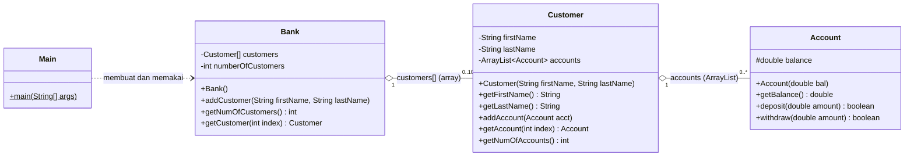
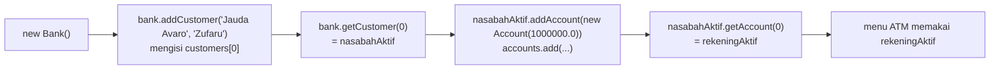
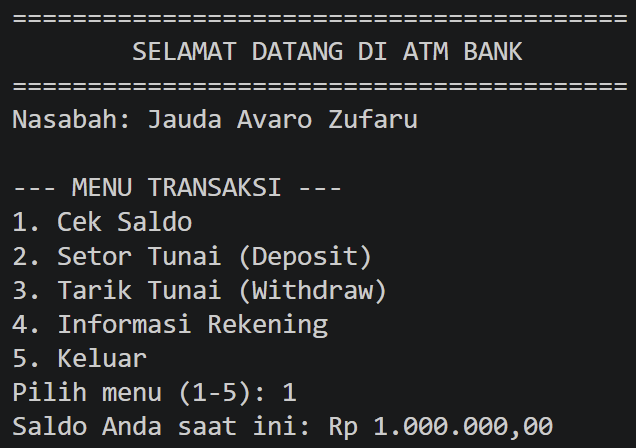
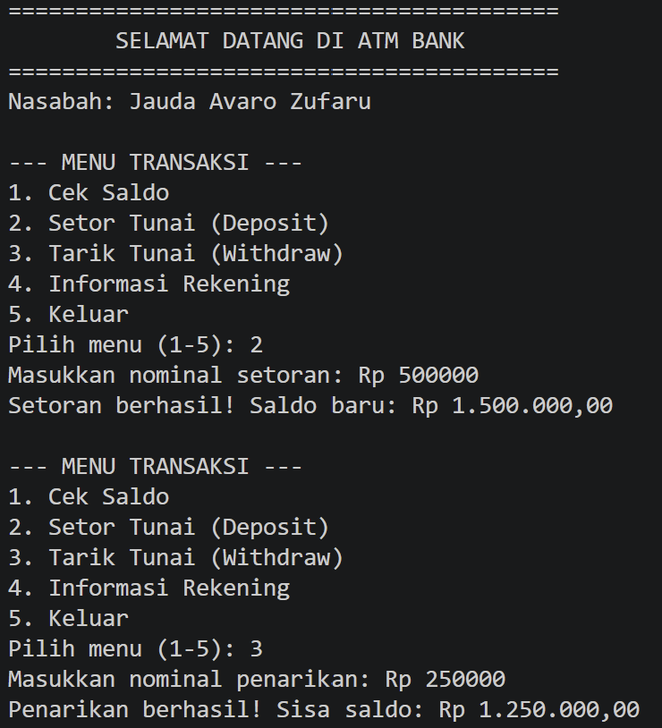
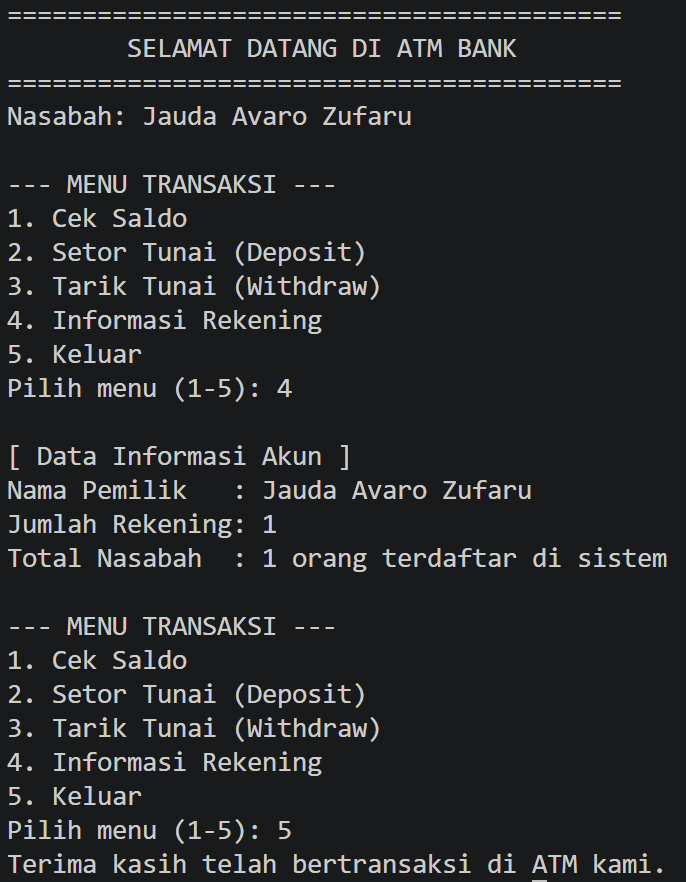

# LATIHAN PEMROGRAMAN BERORIENTASI OBJEK: ARRAY DAN ARRAYLIST

### Simulasi ATM Bank Sederhana dengan Array of Objects dan ArrayList


-5382A1)


Program terminal yang meniru mesin ATM: nasabah dapat melihat saldo, menyetor dan menarik uang, serta melihat informasi rekeningnya. Di balik menu tersebut terdapat tiga kelas yang saling berelasi, yaitu `Bank`, `Customer`, dan `Account`. Latihan ini sengaja memakai dua cara penyimpanan kumpulan objek dalam satu program. `Bank` menyimpan nasabah di **array of objects** berukuran tetap, sedangkan `Customer` menyimpan rekening di **`ArrayList`** yang ukurannya bertambah sesuai kebutuhan, sehingga perbedaan keduanya dapat dibandingkan langsung di kode.

---

## Daftar Isi

1. [Identitas](#1-identitas)
2. [Perintah Tugas dan Pemenuhannya](#2-perintah-tugas-dan-pemenuhannya)
3. [Deskripsi Program](#3-deskripsi-program)
4. [Struktur Proyek dan Rancangan Kelas](#4-struktur-proyek-dan-rancangan-kelas)
5. [Array dan ArrayList dalam Program](#5-array-dan-arraylist-dalam-program)
6. [Rincian Setiap Kelas](#6-rincian-setiap-kelas)
7. [Library Tambahan](#7-library-tambahan)
8. [Cara Menjalankan Program](#8-cara-menjalankan-program)
9. [Skenario Pengujian dan Screenshot](#9-skenario-pengujian-dan-screenshot)
10. [Catatan Perancangan dan Batasan](#10-catatan-perancangan-dan-batasan)

---

## 1. Identitas

| | |
|---|---|
| **Nama** | Jauda Avaro Zufaru |
| **NIM** | F1D02410059 |
| **Kelas** | 5C |
| **Mata kuliah** | Pemrograman Berorientasi Objek (MBS1302137) |
| **Dosen pengampu** | Royana Afwani, S.T., M.T. |
| **Program studi** | Teknik Informatika, Fakultas Teknik, Universitas Mataram |
| **Tugas** | 5C - Latihan/Eksplorasi Materi Array dan ArrayList |

---

## 2. Perintah Tugas dan Pemenuhannya

Penjelasan latihan terdapat pada halaman 26–31 materi *PBO 4 - Array and ArrayList*. Mahasiswa diminta mengeksplorasi pembuatan dan pemanggilan objek (array) beserta method-methodnya di dalam method `main`, dan secara opsional membuat menu seperti ATM sederhana memakai `java.util.Scanner`. Repositori harus berisi kode dan README yang memuat screenshot serta informasi library tambahan jika ada.

| Ketentuan | Status | Uraian |
|---|---|---|
| Membuat dan memanggil objek beserta method-methodnya di `main` | Terpenuhi | `Main` membuat `Bank`, menambah nasabah, membuat `Account`, lalu memanggil `deposit`, `withdraw`, `getBalance`, dan lainnya ([Bagian 6](#6-rincian-setiap-kelas)) |
| Penggunaan array dan ArrayList | Terpenuhi | `Customer[]` di `Bank` dan `ArrayList<Account>` di `Customer` ([Bagian 5](#5-array-dan-arraylist-dalam-program)) |
| Menu ATM sederhana dengan `Scanner` (opsional) | Terpenuhi | Lima menu transaksi di `Main` |
| README berisi screenshot | Terpenuhi | 3 screenshot ([Bagian 9](#9-skenario-pengujian-dan-screenshot)) |
| README berisi informasi library tambahan | Terpenuhi | `java.util.Scanner` dan `java.util.ArrayList` ([Bagian 7](#7-library-tambahan)) |

---

## 3. Deskripsi Program

Saat program dijalankan, `Main` membuat sebuah objek `Bank`, mendaftarkan satu nasabah bernama **Jauda Avaro Zufaru**, lalu membukakan satu rekening dengan saldo awal **Rp1.000.000**. Setelah itu program menampilkan menu transaksi yang berulang sampai pengguna memilih keluar.

| Menu | Nama | Yang dilakukan program |
|---|---|---|
| 1 | Cek Saldo | Menampilkan saldo rekening aktif |
| 2 | Setor Tunai (Deposit) | Meminta nominal, menambah saldo jika nominal lebih dari 0 |
| 3 | Tarik Tunai (Withdraw) | Meminta nominal, mengurangi saldo jika nominal lebih dari 0 dan saldo mencukupi |
| 4 | Informasi Rekening | Menampilkan nama pemilik, jumlah rekening milik nasabah, dan jumlah nasabah di bank |
| 5 | Keluar | Menghentikan perulangan dan menutup `Scanner` |

Pilihan di luar angka 1 sampai 5 dijawab dengan pesan "Pilihan tidak valid", lalu menu ditampilkan kembali.

---

## 4. Struktur Proyek dan Rancangan Kelas

### 4.1 Struktur Folder

```text
Latihan_ArrayList/
├── src/
│   ├── Account.java    # rekening: saldo, setor, tarik
│   ├── Customer.java   # nasabah: nama dan daftar rekening (ArrayList)
│   ├── Bank.java       # bank: daftar nasabah (array of objects)
│   └── Main.java       # menu ATM interaktif
├── bin/                # hasil kompilasi (.class)
├── screenshots/        # bukti keluaran program
└── README.md
```

### 4.2 Diagram Kelas



Relasi antarkelas dibaca sebagai "memiliki" (*has-a*): sebuah bank memiliki banyak nasabah, dan seorang nasabah memiliki banyak rekening. Batas `0..10` pada relasi `Bank` berasal dari ukuran array yang ditetapkan di konstruktor, sedangkan relasi `Customer` tidak memiliki batas karena memakai `ArrayList`.

---

## 5. Array dan ArrayList dalam Program

### 5.1 Array of Objects pada `Bank`

```java
private Customer[] customers;
private int numberOfCustomers;

public Bank() {
    this.customers = new Customer[10];   // ukuran ditetapkan sekali, tidak bisa berubah
    this.numberOfCustomers = 0;
}

public void addCustomer(String firstName, String lastName) {
    if (this.numberOfCustomers < this.customers.length) {
        Customer newCustomer = new Customer(firstName, lastName);
        this.customers[this.numberOfCustomers] = newCustomer;
        this.numberOfCustomers++;
    } else {
        System.out.println("Kapasitas bank penuh!");
    }
}
```

Array dibuat dengan 10 slot yang awalnya bernilai `null`. Karena `customers.length` selalu 10 walaupun baru satu slot terisi, kelas `Bank` memerlukan variabel `numberOfCustomers` untuk mencatat berapa nasabah yang benar-benar ada. Variabel ini sekaligus menjadi indeks slot kosong berikutnya, dan menjadi batas pemeriksaan di `getCustomer()` agar slot yang masih `null` tidak pernah dikembalikan.

### 5.2 ArrayList pada `Customer`

```java
private ArrayList<Account> accounts;

public Customer(String firstName, String lastName) {
    this.firstName = firstName;
    this.lastName = lastName;
    this.accounts = new ArrayList<Account>();   // mulai kosong, tumbuh otomatis
}

public void addAccount(Account acct) {
    this.accounts.add(acct);
}

public int getNumOfAccounts() {
    return this.accounts.size();
}
```

`ArrayList` mengatur kapasitasnya sendiri. Rekening cukup ditambahkan dengan `add()`, jumlahnya diambil dengan `size()`, dan elemennya dibaca dengan `get()`. Tidak diperlukan variabel penghitung tambahan seperti pada `Bank`.

### 5.3 Perbandingan

| Aspek | Array (`Customer[]` di `Bank`) | ArrayList (`ArrayList<Account>` di `Customer`) |
|---|---|---|
| Ukuran | Tetap, ditentukan saat dibuat (`new Customer[10]`) | Dinamis, bertambah otomatis saat `add()` |
| Menambah elemen | Mengisi slot `customers[numberOfCustomers]` lalu menaikkan penghitung | `accounts.add(acct)` |
| Mengetahui jumlah isi | Variabel `numberOfCustomers` yang dikelola sendiri | `accounts.size()` |
| Mengambil elemen | `customers[index]` | `accounts.get(index)` |
| Jika kapasitas habis | Harus ditangani sendiri (program mencetak "Kapasitas bank penuh!") | Tidak terjadi, kapasitas diperbesar otomatis |
| Jenis isi | Boleh tipe primitif maupun objek | Hanya objek (tipe primitif harus memakai kelas pembungkus seperti `Integer`) |
| Pustaka | Bagian dari bahasa Java, tanpa `import` | Perlu `import java.util.ArrayList` |

Kedua method pengambil data, `Bank.getCustomer()` dan `Customer.getAccount()`, sama-sama memeriksa indeks terlebih dahulu dan mengembalikan `null` jika indeks di luar jangkauan. Dengan begitu, kesalahan indeks tidak langsung menghentikan program dengan `ArrayIndexOutOfBoundsException` atau `IndexOutOfBoundsException`.

---

## 6. Rincian Setiap Kelas

| Kelas | Atribut | Method | Keterangan |
|---|---|---|---|
| `Account` | `balance` (`protected double`) | `getBalance()`, `deposit(amount)`, `withdraw(amount)` | `deposit` hanya menerima nominal lebih dari 0. `withdraw` hanya berhasil jika nominal lebih dari 0 dan tidak melebihi saldo. Keduanya mengembalikan `boolean` sebagai tanda berhasil atau gagal |
| `Customer` | `firstName`, `lastName` (`private String`), `accounts` (`private ArrayList<Account>`) | `getFirstName()`, `getLastName()`, `addAccount(acct)`, `getAccount(index)`, `getNumOfAccounts()` | Menyimpan identitas nasabah dan seluruh rekeningnya |
| `Bank` | `customers` (`private Customer[]`), `numberOfCustomers` (`private int`) | `addCustomer(first, last)`, `getNumOfCustomers()`, `getCustomer(index)` | Membuat objek `Customer` sendiri di dalam `addCustomer`, lalu menyimpannya ke array |
| `Main` | tidak ada | `main(args)` | Menyiapkan data awal dan menjalankan menu ATM |

Hasil `boolean` dari `deposit` dan `withdraw` dipakai langsung oleh `Main` untuk memilih pesan yang ditampilkan:

```java
if (rekeningAktif.withdraw(tarik)) {
    System.out.printf("Penarikan berhasil! Sisa saldo: Rp %,.2f\n", rekeningAktif.getBalance());
} else {
    System.out.println("Gagal: Saldo tidak mencukupi atau nominal tidak valid.");
}
```

Alur pembuatan objek di awal `main`:



---

## 7. Library Tambahan

Program tidak memakai library eksternal. Dua kelas dari pustaka standar Java yang perlu di-`import`:

| Kelas | Paket | Dipakai di | Fungsi |
|---|---|---|---|
| `Scanner` | `java.util` | `Main.java` | Membaca pilihan menu (`nextInt()`) dan nominal uang (`nextDouble()`) dari papan ketik |
| `ArrayList` | `java.util` | `Customer.java` | Menampung daftar rekening milik nasabah dengan ukuran dinamis |

---

## 8. Cara Menjalankan Program

### 8.1 Kebutuhan

| Komponen | Keterangan |
|---|---|
| Bahasa | Java |
| Versi | JDK 8 atau lebih baru |
| Library | Tidak ada, hanya pustaka bawaan JDK (`java.util`) |
| Sistem operasi | Windows, Linux, atau macOS |

Pastikan JDK sudah terpasang dengan perintah `java -version` dan `javac -version`.

### 8.2 Melalui Terminal

1. Clone repositori, lalu masuk ke foldernya.

   ```bash
   git clone https://github.com/avarozufaru/Latihan_ArrayList.git
   cd Latihan_ArrayList
   ```

2. Kompilasi semua berkas sumber ke folder `bin`.

   ```bash
   javac -d bin src/*.java
   ```

   Pada Command Prompt Windows, jika pola `src/*.java` tidak dikenali, gunakan `javac -d bin src\*.java`.

3. Jalankan kelas `Main`, lalu pilih menu dengan mengetik angka 1 sampai 5.

   ```bash
   java -cp bin Main
   ```

### 8.3 Melalui Visual Studio Code

Buka folder proyek, pastikan ekstensi **Extension Pack for Java** sudah terpasang, lalu buka `src/Main.java` dan klik **Run** di atas method `main`. Masukan diketik pada panel Terminal.

### 8.4 Catatan Penggunaan

- Pilihan menu harus berupa bilangan bulat. Mengetik huruf akan menghentikan program dengan `InputMismatchException`.
- Nominal uang ditulis tanpa titik pemisah ribuan, misalnya `500000`.
- Format angka pada keluaran mengikuti pengaturan bahasa komputer. Pada Windows berbahasa Indonesia, saldo tampil seperti `Rp 1.000.000,00`, sedangkan pada pengaturan bahasa Inggris tampil seperti `Rp 1,000,000.00`.

---

## 9. Skenario Pengujian dan Screenshot

### 9.1 Skenario Uji

Saldo awal adalah Rp1.000.000. Skenario dijalankan berurutan, sehingga saldo pada satu baris merupakan lanjutan dari baris sebelumnya.

| # | Menu | Masukan | Hasil yang diharapkan | Saldo setelahnya |
|---|---|---|---|---|
| 1 | 1 | – | `Saldo Anda saat ini: Rp 1.000.000,00` | 1.000.000 |
| 2 | 2 | `500000` | `Setoran berhasil! Saldo baru: Rp 1.500.000,00` | 1.500.000 |
| 3 | 3 | `250000` | `Penarikan berhasil! Sisa saldo: Rp 1.250.000,00` | 1.250.000 |
| 4 | 3 | `5000000` | `Gagal: Saldo tidak mencukupi atau nominal tidak valid.` | 1.250.000 |
| 5 | 2 | `-1` | `Gagal: Nominal setoran harus lebih dari 0.` | 1.250.000 |
| 6 | 4 | – | Nama pemilik, `Jumlah Rekening: 1`, `Total Nasabah  : 1 orang terdaftar di sistem` | 1.250.000 |
| 7 | 9 | – | `Pilihan tidak valid, silakan masukkan angka 1 sampai 5.` | 1.250.000 |
| 8 | 5 | – | `Terima kasih telah bertransaksi di ATM kami.` lalu program berhenti | – |

Skenario 1–3, 6, dan 8 terlihat pada screenshot di bawah. Skenario 4, 5, dan 7 menguji penanganan masukan yang salah.

### 9.2 Screenshot

#### 1. Inisialisasi Akun dan Cek Saldo

Program menampilkan nama nasabah yang dibuat di awal `main`, lalu menu 1 menampilkan saldo awal rekening.



#### 2. Setor dan Tarik Tunai

Menu 2 menyetor Rp500.000 sehingga saldo menjadi Rp1.500.000, lalu menu 3 menarik Rp250.000 sehingga sisa saldo menjadi Rp1.250.000.



#### 3. Informasi Rekening dan Keluar

Menu 4 menampilkan jumlah rekening yang diambil dari `ArrayList` (`getNumOfAccounts()`) dan jumlah nasabah yang diambil dari penghitung array (`getNumOfCustomers()`). Menu 5 menutup program.



---

## 10. Catatan Perancangan dan Batasan

### 10.1 Keputusan Perancangan

1. **Dua struktur data dipakai berdampingan.** Array dipakai untuk nasabah karena mengikuti contoh kelas `Bank` pada materi, sedangkan `ArrayList` dipakai untuk rekening sehingga perbedaan cara menambah, menghitung, dan mengambil elemen dapat dibandingkan dalam satu program.
2. **`Bank` membuat objek `Customer` sendiri.** Method `addCustomer` menerima nama, bukan objek, sehingga hanya `Bank` yang menentukan kapan dan di slot mana nasabah baru disimpan.
3. **Hasil transaksi dikembalikan sebagai `boolean`.** `Account` tidak mencetak pesan apa pun, sehingga kelas ini tetap dapat dipakai ulang di antarmuka lain (misalnya GUI), sedangkan pesan untuk pengguna diatur di `Main`.
4. **Pemeriksaan indeks sebelum mengambil elemen.** `getCustomer()` dan `getAccount()` mengembalikan `null` untuk indeks yang tidak valid, bukan melempar exception.

### 10.2 Batasan yang Disadari

1. Kapasitas bank tetap 10 nasabah karena memakai array. Penambahan ke-11 hanya mencetak pesan "Kapasitas bank penuh!".
2. Menu ATM hanya melayani satu nasabah dan satu rekening (indeks 0). Belum ada menu untuk menambah nasabah atau membuka rekening baru dari terminal.
3. Atribut `balance` pada `Account` bersifat `protected`, sehingga kelas lain di paket yang sama masih dapat mengubahnya langsung. Mengubahnya menjadi `private` akan membuat enkapsulasinya lebih ketat.
4. Masukan selain angka tidak divalidasi dan akan menghentikan program dengan `InputMismatchException`.
5. Data tidak disimpan ke berkas, sehingga saldo kembali ke Rp1.000.000 setiap kali program dijalankan.
