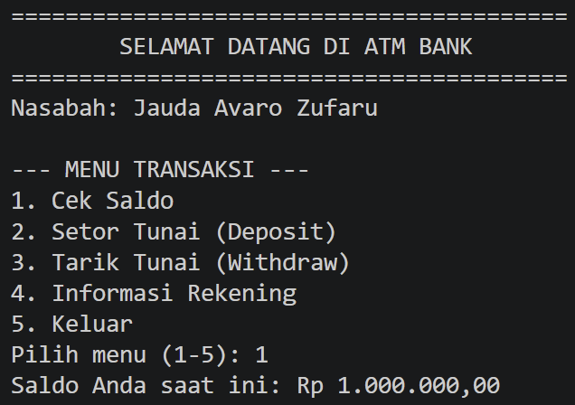
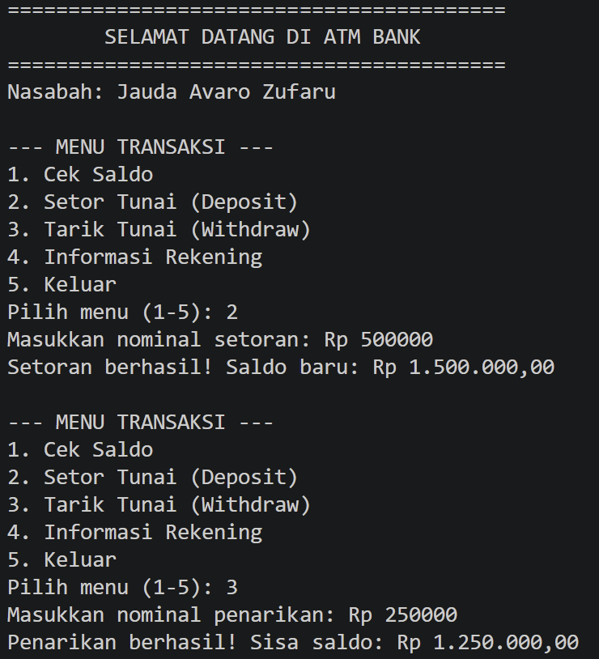
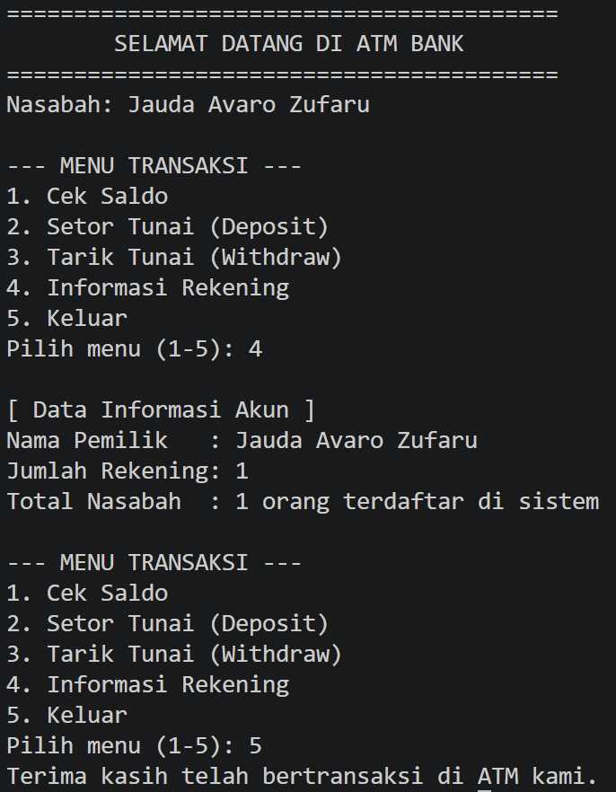

# Tugas PBO - Eksplorasi Array dan ArrayList (Sistem ATM Sederhana)

## Identitas Saya
* **Nama  :** Jauda Avaro Zufaru
* **NIM   :** F1D02410059
* **Kelas :** Pemrograman Berorientasi Objek (PBO) - 5C

---

## Deskripsi Singkat
Program ini mengimplementasikan konsep Pemrograman Berorientasi Objek (PBO) mengenai relasi kelas serta perbandingan penerapan struktur data **Array of Objects** dan **ArrayList** pada Java. Program disimulasikan melalui antarmuka baris perintah (*Command Line Interface* / CLI) interaktif menyerupai mesin ATM.

## Struktur dan Arsitektur Kelas
1. **`Account.java`**: Merepresentasikan rekening nasabah. Menyimpan saldo (`balance`) dan memproses transaksi `deposit` (setor) serta `withdraw` (tarik) dengan validasi batas saldo.
2. **`Customer.java`**: Menyimpan identitas nasabah (`firstName`, `lastName`) dan mengelola kumpulan akun rekening menggunakan struktur data dinamis `java.util.ArrayList<Account>`.
3. **`Bank.java`**: Entitas pengelola sistem perbankan. Mengelola data nasabah menggunakan **Array of Objects (`Customer[]`)** berukuran tetap dan indeks pelacak `numberOfCustomers` sesuai instruksi materi slide perkuliahan.
4. **`Main.java`**: Driver class utama yang menginisialisasi bank, menambahkan nasabah, menetapkan akun awal, serta menjalankan antarmuka menu ATM interaktif berbasis terminal.

## Library Tambahan yang Digunakan
* `java.util.Scanner`: Digunakan pada `Main.java` untuk membaca input dinamis dari keyboard pengguna.
* `java.util.ArrayList`: Digunakan pada `Customer.java` untuk menampung daftar rekening nasabah secara fleksibel.

---

## Bukti Hasil Eksekusi Program (Output)

### 1. Inisialisasi Akun & Menu Cek Saldo

### 2. Transaksi Setor dan Tarik Tunai

### 3. Informasi Akun dan Keluar Program
